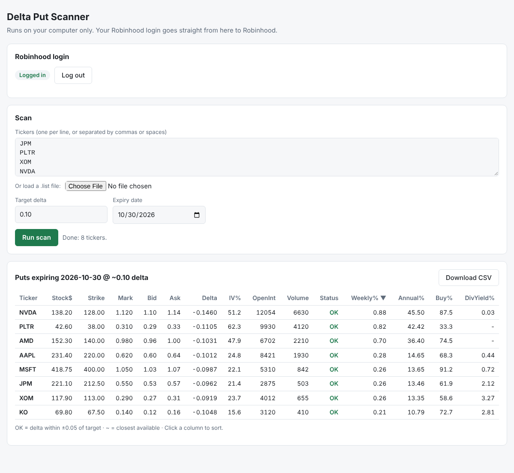
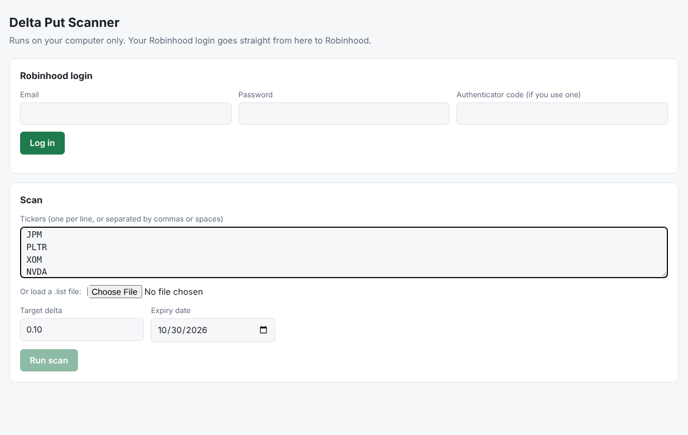
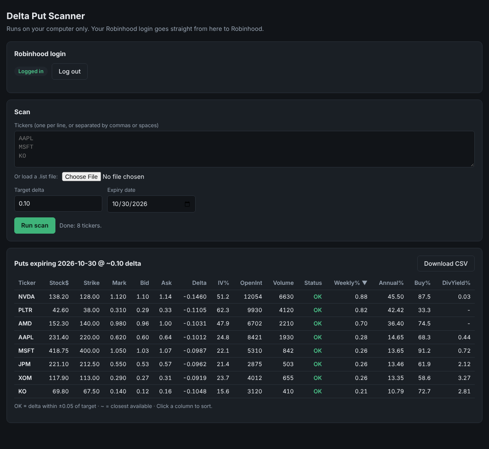

# Put Scanner

A free tool for people who sell cash-secured puts. Give it a list of tickers, a target delta (for example 0.10) and an expiry date, and it finds the put on each ticker whose delta is closest to your target, using your own Robinhood account for live option data.

For each ticker it shows the stock price, strike, mark, bid/ask, delta, implied volatility, open interest, volume, weekly and annualized return (mark ÷ strike), analyst buy %, and dividend yield, and saves the results to a CSV file. It is read-only and never places orders.

There are two ways to run it, both on your own computer:

- **Browser version** (`put_scanner_web.py`): a page in your browser with a login form, sortable results and a CSV download.
- **Terminal version** (`put_scanner.py`): prints the table in the terminal.



<sub>Screenshots use made-up sample data.</sub>

## Setup

```bash
python3 -m venv venv
source venv/bin/activate
pip3 install robin_stocks tabulate
```

## Usage

```bash
python3 put_scanner.py -f tickers.list -d 0.10 -t 15May2026
python3 put_scanner.py -f tickers.list -d 0.10 -t 5/15/2026
python3 put_scanner.py -f tickers.list -d 0.10 -t 2026-05-15
python3 put_scanner.py -f tickers.list -d 0.10          # defaults to next Friday
```

- `-f` text file with one ticker per line (required)
- `-d` target delta as a positive number (default 0.10)
- `-t` expiry date

You are asked for your Robinhood email and password at login. The session is saved to `~/.tokens/robinhood.pickle`, which is never committed.

## Browser version (runs on your computer)

The same scan with a page in your browser instead of the terminal. It runs only on your own computer (served from `127.0.0.1`), and your Robinhood login goes straight from it to Robinhood.

```bash
source venv/bin/activate
python3 put_scanner_web.py
```

Your browser opens `http://127.0.0.1:8765`. Log in, paste tickers (or load a `.list` file), pick a delta and an expiry date, and click **Run scan**. If Robinhood asks for a texted or emailed code, a box for it appears on the page; if it asks you to approve in the app, approve it there. Results can be sorted by clicking a column, and **Download CSV** saves the same CSV the terminal version writes. If a saved session exists it is used automatically, and **Log out** deletes it.

<p>
  
  
</p>

Options: `--port 9000` to use another port, `--no-browser` to not open the browser. Press Ctrl+C in the terminal to stop.

## Troubleshooting

If login fails, delete the saved session and run again:

```bash
rm ~/.tokens/robinhood.pickle
```

## Disclaimer

This tool is for information only and is not financial advice. It uses the unofficial `robin_stocks` library, which Robinhood does not support and which can stop working when Robinhood changes things. Data may be delayed or wrong, so check anything important in Robinhood before you trade. It comes with no warranty, and you use it at your own risk.

## License

[MIT](LICENSE). Free for anyone to use, copy, and change.
